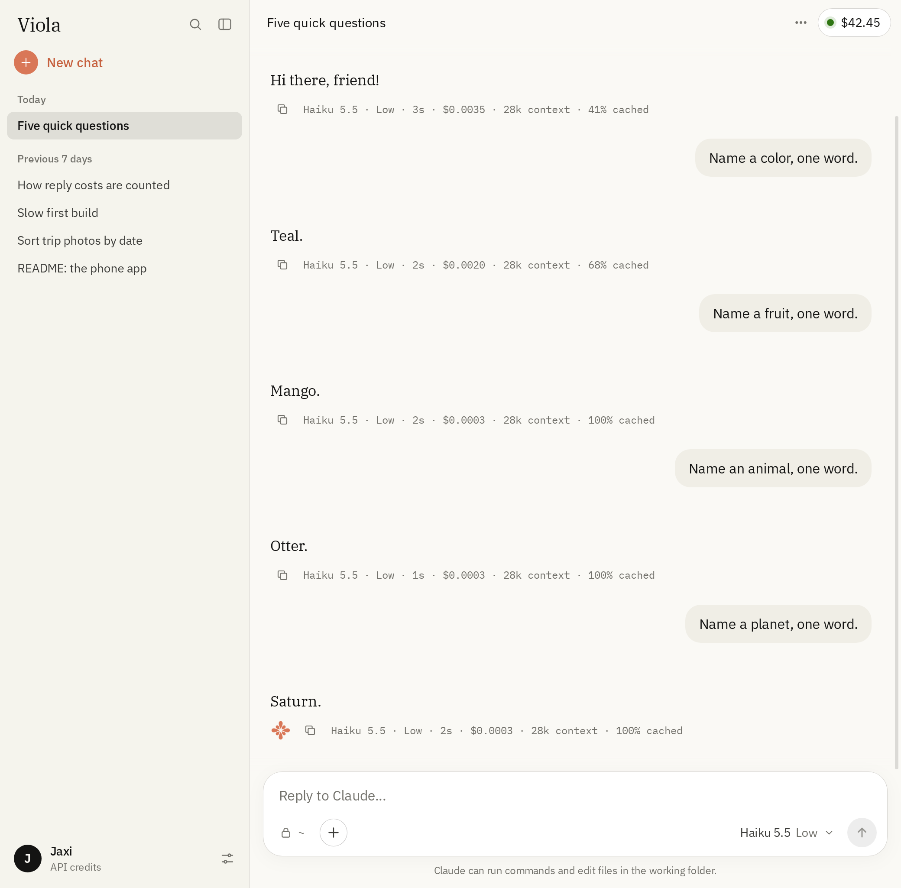

# Viola

A small desktop app for interacting with Claude Code while using API credits. Designed for Max and Ultra subscribers to get the most out of their monthly $100/$200 in API credits, while still working similar to how they normally would.

<picture>
  <source media="(max-width: 640px)" srcset="assets/screenshots/mobile.png">
  
</picture>

Each message runs `claude -p`, streams the `stream-json` output into the window, and resumes the same Claude Code session on the next message, effectively creating one coherent chat between user and assistant. Claude Code still loads `CLAUDE.md`, skills, memory and tools as usual.

Viola keeps Claude Code's input open while it works (`--input-format stream-json`), so you can send another message mid-reply. Claude Code reads it at its next pause, the same way it does in the terminal, and the reply carries on below it.

## Features

- **Credits counter:** After setting your credits amount once, Viola subtracts the running cost of using the app, giving you a very close approximation of your current credits (within 1 cent in testing). Adding an Admin API key allows Viola to refresh the credit amount to its exact amount once every day, as Anthropic reports it.
- **Themes:** A collection of classic claude.ai-style color schemes, popular terminal palettes, and even a Windows 95-inspired theme. Includes the ability to match the app icon to the currently used theme.
- **Mobile support:** Download or build the Android `.apk`, or connect to the mobile interface with a link on an iPhone or any other mobile device.
- **Photo/file upload:** Use the app's + button to open a familiar interface to share photos and files with your assistant. Photos are scaled to 2000px before upload. All uploads are saved in `uploads/`, in [Viola's data folder](#notes).
- **Permission modes:** The + button also allows you to pick between *Auto, Accept edits, and Plan* modes, as well as giving you the option to *Bypass* permissions entirely.
- **Prompt caching visibility:** Every turn, see what % was cached.
- **Terminal chats in Viola:** Off by default. Allows you to view every Claude Code conversation from your PC in Viola, and continue them inside it.
- **Assistant naming:** Call Claude a different name? Viola allows you to name your assistant whatever you would like, and reflects this across the app.

## Installing

Viola needs [Claude Code](https://docs.claude.com/en/docs/claude-code) and an Anthropic API key on the computer it runs on. Phones connect to that computer, so set up a computer first. Pick your system:

<details>
<summary><b>Linux</b></summary>

Download the package for your system from the [latest release](https://github.com/cmyksoda/Viola/releases/latest) and install it. Your package manager will resolve all dependencies (Python 3, GTK 3, WebKit2GTK 4.1):

```sh
sudo dnf install ./viola-1.0.0-1.noarch.rpm   # Fedora
sudo apt install ./viola_1.0.0_all.deb        # Ubuntu, Debian
```

To run from the source folder instead:

```sh
./install.sh   # adds Viola to the app launcher and a `viola` command
viola           # opens the window
```

This needs Python 3, GTK 3 and WebKit2GTK 4.1 (`webkit2gtk4.1` on Fedora), and the `claude` CLI. `packaging/build.sh` builds the .rpm and .deb.

</details>

<details>
<summary><b>macOS</b></summary>

Download `Viola-macOS-Apple-Silicon.zip` or `Viola-macOS-Intel.zip` from the [latest release](https://github.com/cmyksoda/Viola/releases/latest). Python comes inside, so there's nothing else to install apart from Claude Code.

Unzip it and move Viola to Applications. The first time you open it, macOS says it can't check Viola for malware, since it isn't signed with a paid Apple developer account. Open System Settings → Privacy & Security, scroll down, and choose **Open Anyway**. After that it opens like any other app.

To run from the source folder instead, you need Python 3.9 or newer. Viola's window comes from [pywebview](https://pywebview.flowrl.com/), which uses Safari's web view. Without pywebview, Viola opens in your browser instead.

```sh
python3 -m venv .venv
.venv/bin/pip install -r requirements.txt
.venv/bin/python viola.py
```

</details>

<details>
<summary><b>Windows</b></summary>

Download `Viola.exe` from the [latest release](https://github.com/cmyksoda/Viola/releases/latest) and double-click it. Python comes inside, so there's nothing else to install apart from Claude Code. If Windows says it protected your PC, choose **More info** → **Run anyway**. Viola's window uses Microsoft Edge's WebView2, which comes with Windows 11 and up-to-date Windows 10.

To run from the source folder instead, you need Python 3.9 or newer from [python.org](https://www.python.org/downloads/windows/) (the Microsoft Store version keeps its own copy of `%APPDATA%`). Viola's window comes from [pywebview](https://pywebview.flowrl.com/). Without it, Viola opens in your browser instead.

```bat
py -m venv .venv
.venv\Scripts\pip install -r requirements.txt
.venv\Scripts\pythonw viola.py
```

`pythonw` starts Viola without a console window, which also hides its messages, so use `python` instead if something goes wrong.

</details>

<details>
<summary><b>Android</b></summary>

The Android app is a remote for Viola on your computer. Claude Code's own `/remote-control` refuses API keys, so Viola shares its own page with your phone instead.

1. Download `viola-1.0.0.apk` from the [latest release](https://github.com/cmyksoda/Viola/releases/latest) and install it.
2. In Viola on your computer, open Settings → Remote and copy the link. With [Tailscale](https://tailscale.com/) on both devices, the link works from anywhere, over HTTPS when your tailnet has certificates enabled (plain HTTP on the Tailscale IP otherwise). Without Tailscale, Viola listens on your home network instead, so the phone has to be on the same Wi-Fi, and the link isn't encrypted: anyone on that network who can see the traffic could use it to control Viola, and through Viola your computer. Only use it on a network you trust. Sharing on the home network stays off after Viola restarts, since a laptop may be somewhere else by then.
3. Open the app and paste the link on first launch.

`android/build.sh` builds the app from source.

</details>

<details>
<summary><b>iOS</b></summary>

There's no App Store app. An iPhone or iPad opens Viola's own page from your computer, which Viola shares because Claude Code's own `/remote-control` refuses API keys.

1. In Viola on your computer, open Settings → Remote and copy the link. With [Tailscale](https://tailscale.com/) on both devices, the link works from anywhere, over HTTPS when your tailnet has certificates enabled (plain HTTP on the Tailscale IP otherwise). Without Tailscale, Viola listens on your home network instead, so the phone has to be on the same Wi-Fi, and the link isn't encrypted: anyone on that network who can see the traffic could use it to control Viola, and through Viola your computer. Only use it on a network you trust. Sharing on the home network stays off after Viola restarts, since a laptop may be somewhere else by then.
2. Open the link in Safari, then choose Share → **Add to Home Screen**.

Any other device with a browser can open the same link.

</details>

### Options

`viola --server-only` (or `viola.py --server-only`) runs only the backend, for example, to keep it up for your phone. `--browser` opens the UI in your default browser instead. If a backend is already running, the window attaches to it.

### Your API key

Paste your key into Viola's setup screen or Settings, or set `VIOLA_API_KEY`. An `export VIOLA_API_KEY=…` line in `~/.bashrc` or `~/.zshrc` works too, even when Viola starts from the app menu. Viola has its own variable so that Claude Code in your terminal can stay on your subscription; `ANTHROPIC_API_KEY` is only used when nothing else is set.

## Shortcuts

| Keys | Action |
|---|---|
| Enter / Shift+Enter | Send / new line |
| Esc | Stop the reply |
| Ctrl+N or Ctrl+Shift+O | New chat |
| Ctrl+K | Search chats |
| Ctrl+B | Toggle the sidebar |
| `/` at the start | Slash command menu (skills and commands from Claude Code) |

On macOS, ⌘ works in place of Ctrl.

## Notes

- Viola keeps its settings, chats and uploads in `~/.local/share/viola` on Linux, `~/Library/Application Support/Viola` on macOS, and `%APPDATA%\Viola` on Windows.
- On NVIDIA drivers WebKitGTK's DMA-BUF renderer leaves the window blank, so Viola turns it off (`WEBKIT_DISABLE_DMABUF_RENDERER=1`).
- Viola ships the IBM Plex family: Plex Serif for replies, Plex Sans for the interface, and Plex Mono for code and figures like times and costs, all under the SIL Open Font License. The Windows 95 theme uses the Cronyx Helvetica and Courier bitmap fonts from X.Org, under Cronyx's permissive X11-style license. These fonts were picked because [Chicago95](https://github.com/grassmunk/Chicago95) bundles them. `tools/bitmapfont.py` converts them to web fonts.

## Credits

- **IBM Plex** by Mike Abbink and Bold Monday for IBM, the fonts for replies, the interface and code
- **Cronyx Helvetica and Courier** by Cronyx Ltd., with changes by Andrey A. Chernov, the Windows 95 theme's bitmap fonts, found in [Chicago95](https://github.com/grassmunk/Chicago95) by grassmunk
- **Catppuccin, Dracula, Gruvbox, Nord, Rosé Pine, Solarized and Tokyo Night** by their authors, the color palettes of the themes with those names

## License

Viola is free software under the [GNU General Public License, version 3 or later](LICENSE). Some parts use other licenses: the IBM Plex fonts are under the SIL Open Font License 1.1, and the Cronyx fonts, along with the Windows 95 fonts made from them, are under Cronyx's own permissive license. All the texts are in [`licenses/`](licenses/).

Viola isn't affiliated with Anthropic, IBM, or Microsoft.

---

*This project was made with AI assistance. For more information, see [my AI usage statement](https://github.com/cmyksoda/cmyksoda/blob/main/AI_USAGE.md).*
